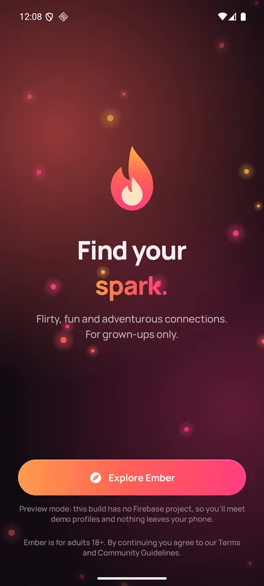
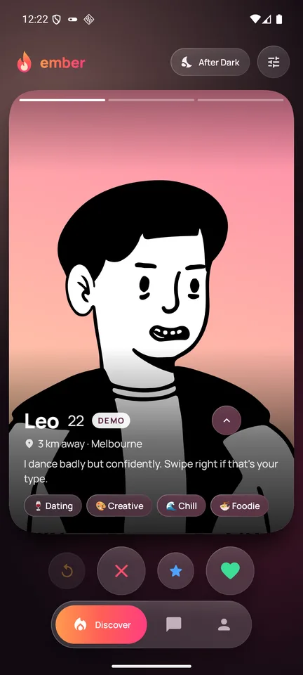
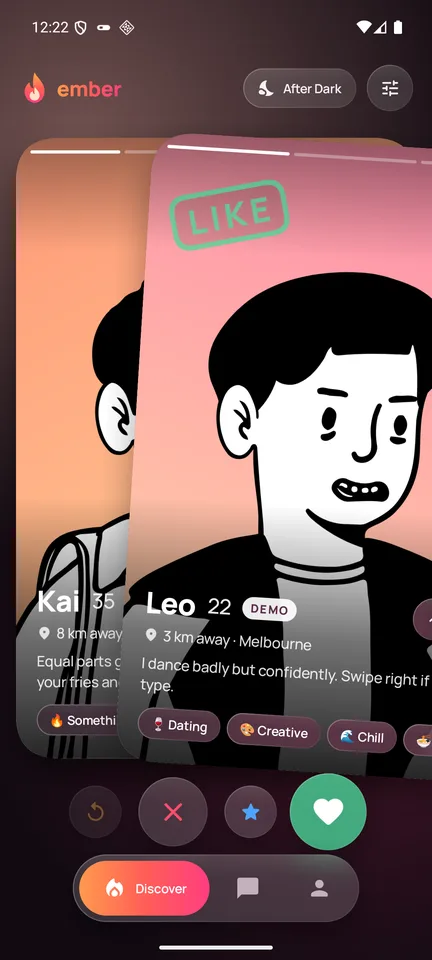
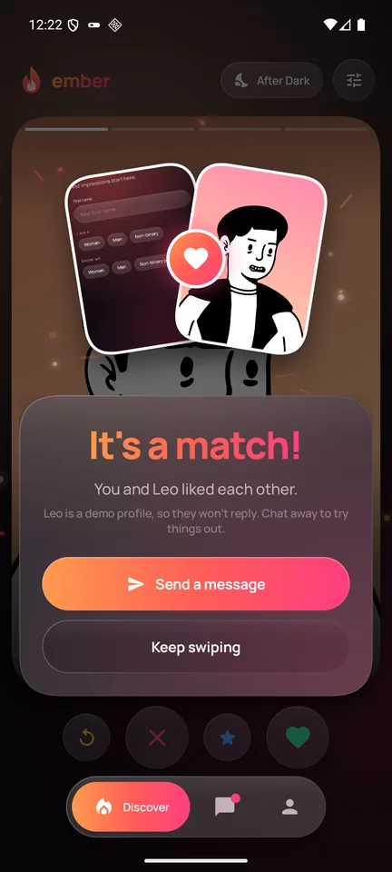
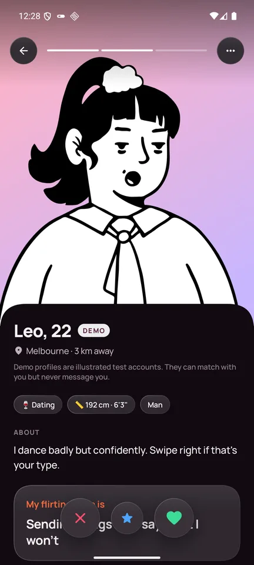
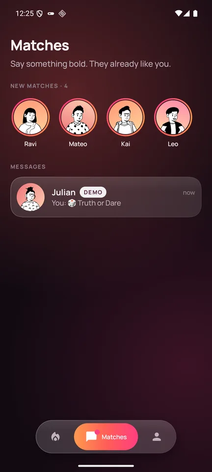
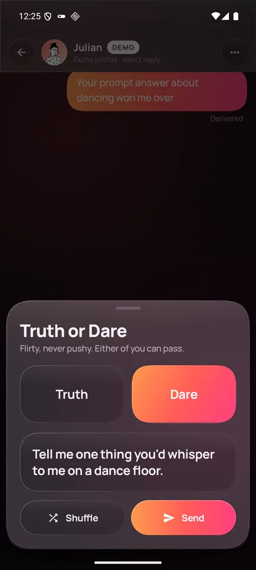
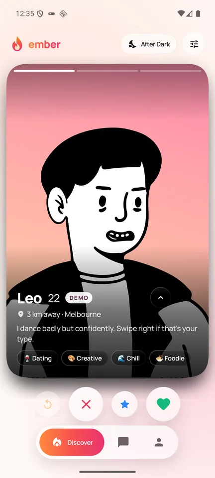

<div align="center">


# Ember

**Flirty, fun and adventurous connections. For grown-ups only (18+).**

A swipe-based dating app for Android with a glassmorphic, Apple-inspired design: physics-based cards, a warm "after dark" palette, private albums with consent built in, and a Firebase backend that never trusts the client.

<a href="https://github.com/Arnav-Dugad/ember-android/releases/latest">
  
</a>

[](https://github.com/Arnav-Dugad/ember-android/releases/latest)
[](https://github.com/Arnav-Dugad/ember-android/actions/workflows/ci.yml)


</div>

<!-- Real captures from the release build (Preview mode). Drop a demo GIF at docs/media/demo.gif and link it here. -->
| Welcome | Discover | Swiping | It's a match |
|---|---|---|---|
|  |  |  |  |
| **Profile** | **Matches** | **Truth or Dare** | **Light theme** |
|  |  |  |  |

> **Install:** download the APK from the latest release and open it. Android will ask you to allow installs from your browser or file manager the first time. After that, Ember updates itself: it checks GitHub Releases on launch and once a day, then downloads, verifies and installs new versions.

## Preview mode vs. Firebase

Ember runs in two modes, picked automatically at startup:

| | Preview mode | Firebase mode |
|---|---|---|
| When | the build has no `google-services.json` | `app/google-services.json` is present |
| Accounts | one local demo user | Email, Google and phone sign-in |
| People | 72 illustrated demo profiles generated on device | real users, plus seeded demo profiles until real sign-ups pass a threshold |
| Data | in memory, gone when the app closes | Firestore, Storage, Cloud Functions |

That lets anyone try the full UI from the release APK before you set up a Firebase project. Demo profiles always wear a **Demo** badge, can match with you for testing, and **never** send messages.

## Features

- **Onboarding:** 18+ age gate (enforced server-side; under-18 accounts are disabled and their data deleted), terms and community guidelines acceptance, then a seven-step profile wizard.
- **Profiles:** up to 6 public photos (EXIF and GPS stripped on upload), bio, cheeky prompts, vibes, interests, height, city-level location only, and what you're looking for.
- **Match-only details:** boundaries and turn-ons that only your matches can read (enforced by security rules).
- **Discovery:** physics swipe deck (rotation around the grab point, velocity flings, spring return, LIKE / NOPE / SUPER stamps, stacked cards), rewind, distance, age and intent filters, and server-side geohash queries.
- **After Dark:** a darker palette that also limits discovery to people open to casual or adventurous connections.
- **Matching:** created only by a Cloud Function when likes are mutual. The match screen has flying photos, an ember burst and a spring headline.
- **Chat:** real-time messages, typing indicator, read receipts, tap-to-reveal image messages, Truth or Dare cards, and push notifications.
- **Private album:** photos are invisible until the owner approves a match, and access can be revoked instantly. Storage rules check access on every read, screenshots are blocked, and viewers see a consent reminder first.
- **Safety:** block, unmatch, report (8 reasons), private lock-screen notifications, and full account deletion.
- **Design:** Haze backdrop blur with a frosted fallback below Android 12, continuous-curvature corners, Manrope typography, an ambient glow tinted by the current photo (Palette API), and haptics on thresholds, matches and presses.
- **Self-update:** an in-app updater backed by GitHub Releases. It checks the SHA-256 of each download, plus its package name and signing certificate, before installing. Add `[mandatory]` to the release notes to require an update.

## Tech

Kotlin, Jetpack Compose, Material 3 (heavily restyled), MVVM, Hilt, Coroutines and Flow, Navigation Compose with type-safe routes and shared elements, Coil 3 (with BlurHash placeholders), Haze 2, DataStore, WorkManager, OkHttp, and Baseline Profiles.

Firebase: Auth, Firestore, Storage, Cloud Functions (TypeScript), Cloud Messaging, App Check (Play Integrity), Remote Config, Crashlytics and Analytics.

```
app/                 Android app (single module, package-by-feature)
  core/              design system (glass, shapes, motion, haptics), image, util, analytics
  data/              models, repository interfaces, Firebase + Preview implementations
  ui/                auth, onboarding, discover, profile, matches, chat, album, safety, settings
  update/            GitHub Releases self-updater (WorkManager + install sheet)
baselineprofile/     Baseline Profile generator (macrobenchmark)
firebase/            rules, indexes, Cloud Functions, seed script, rules tests
docs/                data model, Firebase setup, releasing
```

## Build

Requirements: JDK 17+ (Android Studio's bundled JBR works) and the Android SDK with API 37.

```bash
./gradlew assembleDebug        # debug build, Preview mode unless app/google-services.json exists
./gradlew assembleRelease      # release build (debug-signed unless a keystore is configured)
./gradlew testDebugUnitTest
```

Local signed builds: copy `keystore.properties.example` to `keystore.properties` and fill it in. Both files stay out of git.

## Firebase setup

Follow **[docs/FIREBASE_SETUP.md](docs/FIREBASE_SETUP.md)**. In short:

1. Create a Firebase project on the Blaze plan, then add Android apps `io.github.arnavdugad.ember` and `io.github.arnavdugad.ember.debug`.
2. Download `google-services.json` to `app/` (git-ignored; see `app/google-services.json.sample` for its shape).
3. Enable Auth providers, Firestore, Storage, App Check and Remote Config.
4. Deploy rules and functions with `cd firebase && firebase deploy --only firestore,storage,functions,remoteconfig`.
5. Seed 150 illustrated demo profiles: `cd firebase/seed && npm i && node seed.mjs --bucket <your-bucket>`.

The contract between the app and the backend is documented in [docs/DATA_MODEL.md](docs/DATA_MODEL.md).

## Releasing

See **[docs/RELEASING.md](docs/RELEASING.md)**. Tag `vX.Y.Z` and push it. GitHub Actions then builds an APK signed with the same key every time (from repository secrets), derives `versionName`/`versionCode` from the tag, and publishes the release with auto-generated notes.

## Safety and content

Ember is for adults. Public photos must be non-explicit, and private content is shared only by explicit, revocable consent. Demo data uses CC0 DiceBear illustrations: no photos of real people, nothing explicit.

## License

MIT. Manrope is licensed under the SIL Open Font License ([docs/FONT_LICENSE_OFL.txt](docs/FONT_LICENSE_OFL.txt)).
